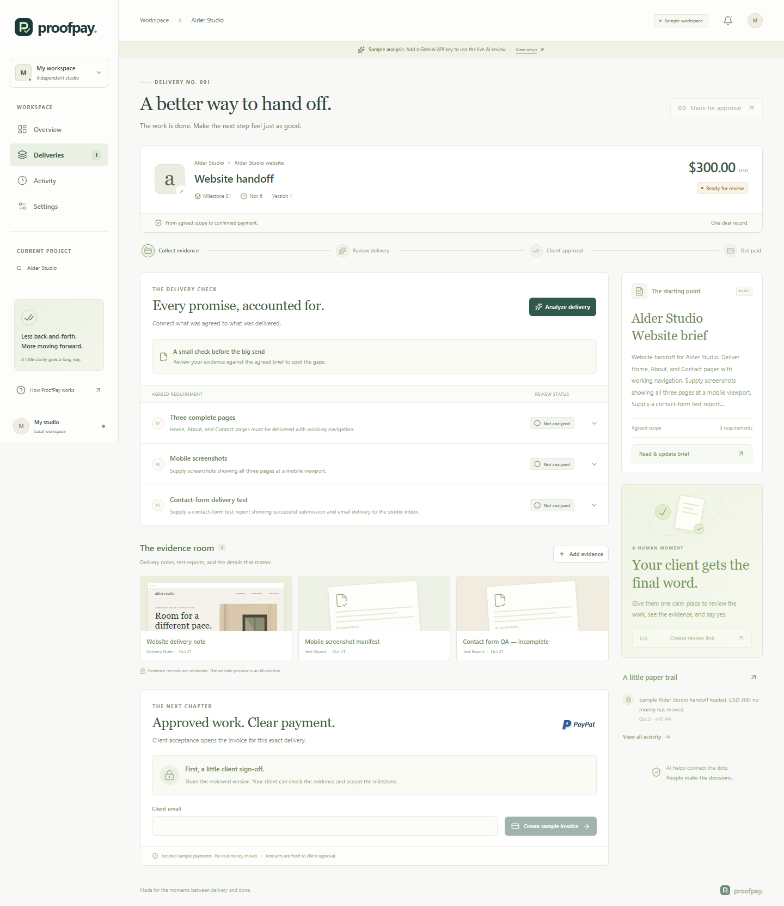

# ProofPay

**Turn delivery evidence into a clear client decision, then an invoice.**

Original project repository: [Pradhyut21/proofpay-paypal-ai-hackathon](https://github.com/Pradhyut21/proofpay-paypal-ai-hackathon).



ProofPay is a hackathon prototype for freelance web designers and their clients. It keeps the agreed scope, a checklist, delivery evidence, client acceptance and PayPal invoice status in one workflow. AI assists with checklist extraction and evidence mapping; a person decides whether to accept the work.

The included Alder Studio example is an original, fictional $300 USD website milestone. Sample analysis and sample payment states are labelled fixtures. They do not represent a model invocation, a PayPal invoice or money moved.

**Current handoff:** a runnable source package. The submitter will add credentials later; real Gemini requests, PayPal sandbox payment and verified webhook delivery remain unverified. The sample walkthrough alone does not complete the PayPal-plus-AI submission demonstration.

**Verified locally:** 15 backend tests pass, TypeScript passes, and the Worker build completes. A real browser exercised the full sample review → client acceptance → invoice → simulated payment flow with no page errors. The 390px mobile layout has no horizontal overflow. See [Validation](docs/VALIDATION.md).

## Run locally

Use Node.js **22.13.0 or later** and npm. From the repository root:

```sh
npm run install:ci
npm run build
```

Apply the SQL migration from `drizzle/` to local D1 using the command in [Setup](docs/SETUP.md), then run:

```sh
npm run dev
```

For a production-bundle preview after migration, use `npm start`.

Open the loopback URL printed by the server, normally `http://localhost:5173`. For the development-only seller identity, navigate to `/signin-with-chatgpt?return_to=/` on that URL. No external credentials are needed to explore the isolated sample workflow. Real Gemini analysis and PayPal sandbox invoicing require the configuration described below.

## Configure integrations

Copy `.dev.vars.example` to the ignored `.dev.vars` file and supply your own Gemini and PayPal **sandbox** values. `.env.example` lists the same contract for deployment systems; do not populate both files. Never commit credentials. Local browser preview is not a public webhook endpoint.

See [Setup and sandbox verification](docs/SETUP.md) for D1 initialization, built preview, secrets, HTTPS webhooks and the real payment checklist. The app runs on the Sites/Vinext Cloudflare Worker runtime; there is no Render deployment configuration because a generic Node service would not provide its D1 or Sites identity bindings.

## Try the story

1. Inspect the Alder Studio brief and the checklist for Home, About, Contact, mobile layouts and a contact form.
2. Review the submitted evidence and the missing mobile Contact evidence.
3. Add the supplied synthetic artifact and analyze the updated evidence.
4. Open client review and accept the current evidence version.
5. Create a PayPal sandbox invoice when configured, or inspect the clearly marked sample simulation.

An AI evidence match is a reading aid. It is not proof of quality, a guarantee of delivery, an escrow service or an adjudication of a dispute.

## Project guide

| Document | Purpose |
| --- | --- |
| [Judge runbook](docs/JUDGE_RUNBOOK.md) | A short walkthrough, sample/live distinctions and edge cases |
| [Setup](docs/SETUP.md) | Local commands and real integration verification |
| [Architecture](docs/ARCHITECTURE.md) | Data flow, identities and action boundaries |
| [API reference](docs/API.md) | Routes, data limits and version rules |
| [Devpost description](docs/DEVPOST.md) | Submission text, tagline and tool disclosure |
| [Demo script](docs/DEMO_SCRIPT.md) | 2:45 shot list and narration |
| [Subtitles](docs/demo.srt) | Timed English subtitle source |
| [YouTube upload package](docs/YOUTUBE_UPLOAD.md) | Title, description, tags and upload record |
| [Submission checklist](docs/SUBMISSION_CHECKLIST.md) | Deliverables and remaining external steps |
| [Validation record](docs/VALIDATION.md) | What has and has not been verified |
| [Provenance](docs/PROVENANCE.md) | Original assets, dependencies and source links |

## Stack and license

React, TypeScript, Vinext, Vite, Tailwind CSS, Cloudflare Workers/D1, Drizzle, Gemini REST and PayPal Invoicing REST. Sites supplies the starter runtime and hosted identity. See `package.json` for dependency versions.

Original project contributions are available under the [MIT License](LICENSE), copyright 2026 Pradhyut21. Third-party packages and bundled vendor files retain their own licenses. Public YouTube upload and final Devpost submission remain separate steps.
