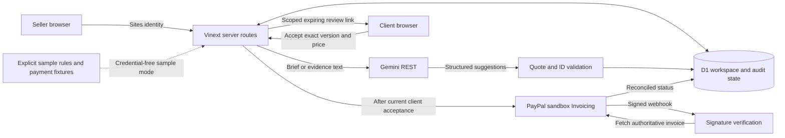

# Architecture

ProofPay is a single-seller milestone prototype. The agreed scope and price are fixed for the sample project. It assesses supplied **text**, including screenshot manifests and QA reports; it does not browse a delivered website, inspect screenshot pixels, execute tests or read an inbox.

## State and identities

- A workspace holds the original brief, extracted requirements, evidence, analysis, client approval, invoice and activity history.
- The seller workspace is keyed to the identity injected by Sites dispatch. Loopback development has an isolated local identity. Direct deployment outside Sites requires its own trusted authentication boundary; client-supplied identity headers must never be trusted on the open internet.
- A review link is a bearer capability for one workspace/version. Anyone with that link can access its review content and exercise its allowed acceptance action until it expires. Treat it as sensitive; it is not independently verified client identity or an electronic-signature service.
- `revision` protects persisted writes; `contentVersion` identifies the brief/evidence version being reviewed. A client accepts an analysis, version, amount and currency together. Changes require renewed review.
- Payment mode is separate from analysis mode. A Gemini key does not configure PayPal, and PayPal credentials do not configure Gemini.

## Evidence assistance

The server sends the brief or supplied evidence to Gemini only when a key is configured. Documents are declared untrusted input, and the model has no payment or acceptance tools. The server validates structured output, requirement IDs and verbatim quotes against stored text. An unsupported conclusion is downgraded rather than silently trusted.

Substring validation checks that a quote exists. It does not establish that the quote is true, complete, relevant enough, or that it entails the proposed finding. Conflicting reports, misleading evidence and subjective quality still require human review. The readiness value summarizes evidence coverage; it is not a calibrated probability or a payment authorization.

The current prototype enables a client review link only when the current analysis marks every requirement `met`. It has no manual override for an uncertain finding. A false negative can therefore block review; evaluating and improving this gate is future work. Even after the gate passes, the client must explicitly accept.

Without a key, the app runs named deterministic sample rules. Custom requirements can remain uncertain. It must not silently present a fixture as an AI response after a provider failure.

## Invoice boundary

The invoice is tied to an accepted version and fixed amount. PayPal credentials stay server-side. Creation, sending and fetching are distinct operations; invoice status is not inferred from the client returning to the application.

The complete provider payload and buyer email are frozen before creation and reused with the same request identifier on retry. A four-minute lease and per-attempt identity prevent an older attempt from releasing or overwriting its successor. Provider reads are bound to the database revision captured before the fetch; a conflict triggers a fresh provider read. A late network failure cannot replace a webhook-confirmed paid or refunded state. Regression tests exercise these races with mocked provider HTTP; actual sandbox behavior still requires credentials.

The webhook route verifies PayPal's message using the registered sandbox webhook ID before reconciling an invoice. A live test must also establish that unrelated invoices, duplicate events and out-of-order notifications do not mark the wrong workspace paid. An invoice recorded externally is distinct from an online payment.

When PayPal is completely unconfigured, sample actions operate only on sample invoices. Partially configured PayPal must display unavailable status instead of pretending a real request succeeded. All money amounts use integer minor units in application state.

## Deployment and data

This project targets the Sites/Vinext Worker runtime with a D1 binding named `DB`. The hosted seller identity is supplied by Sites, not implemented by the client UI. The generated Worker build and local D1 state are disposable outputs and are not source assets.

Client briefs and evidence can contain confidential information. The prototype sends submitted text to the configured AI provider for analysis and stores workspace state in D1. Use synthetic data for judging; obtain permission before using customer material. Production retention, deletion, revocation, rate limiting and broader account onboarding need additional work.
